  

## CH. 01 / THE ARSENAL

  

  

  
  
  

  
  
  
  

  
  

<i>· · · always expanding · · ·</i>

## CH. 02 / THE TRAINING ARC

  
  

  

  

  <picture>
    <source
      media="(prefers-color-scheme: dark)"
      srcset="https://raw.githubusercontent.com/Abhiix0/Abhiix0/output/github-contribution-grid-snake-dark.svg"
    />
    <source
      media="(prefers-color-scheme: light)"
      srcset="https://raw.githubusercontent.com/Abhiix0/Abhiix0/output/github-contribution-grid-snake.svg"
    />
    
  </picture>

## CH. 03 / THE CROSSOVER

  <table width="100%">
    <tr>
      <td width="42%" align="center" valign="middle">
          
      </td>
      <td width="58%" align="center" valign="middle">
        <h3>Have something in mind?</h3>
        

          
        

        

          
        

         
        
      </td>
    </tr>
  </table>

